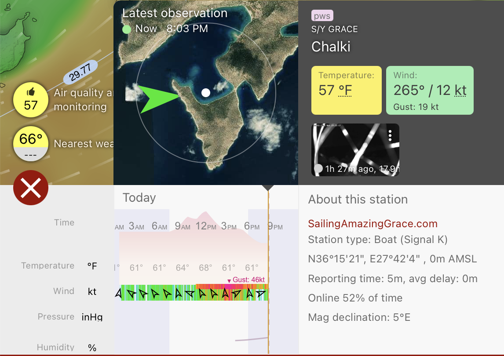
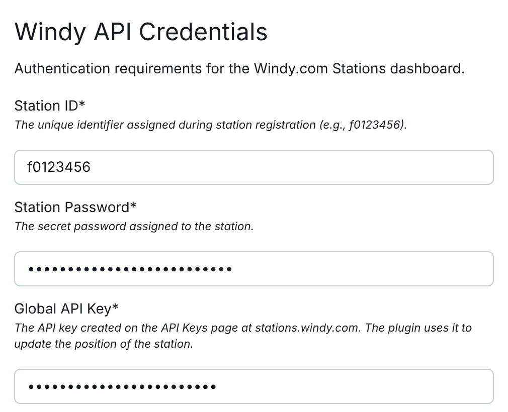
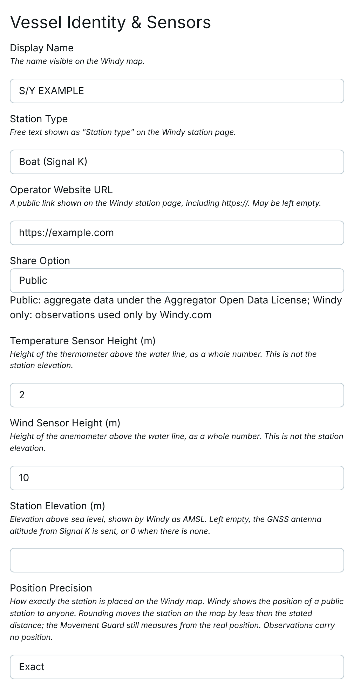
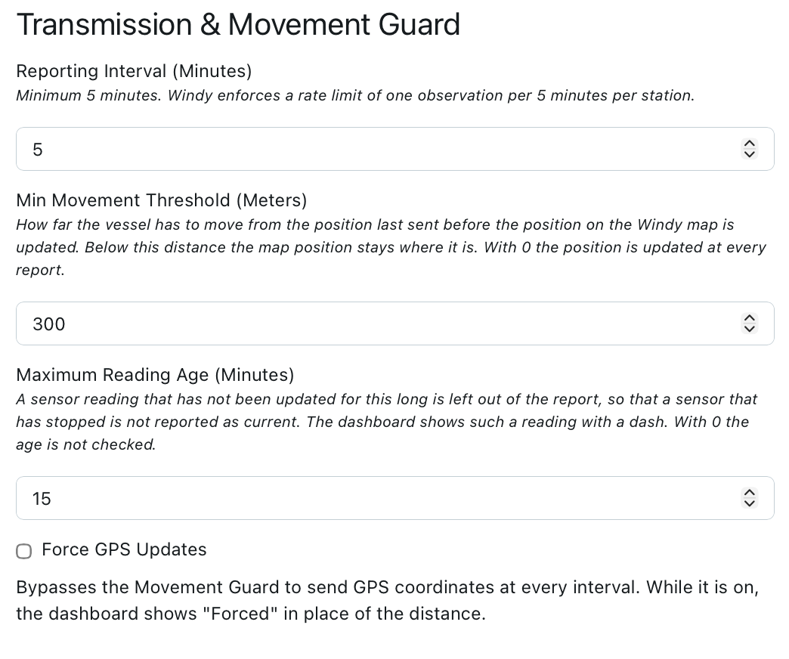
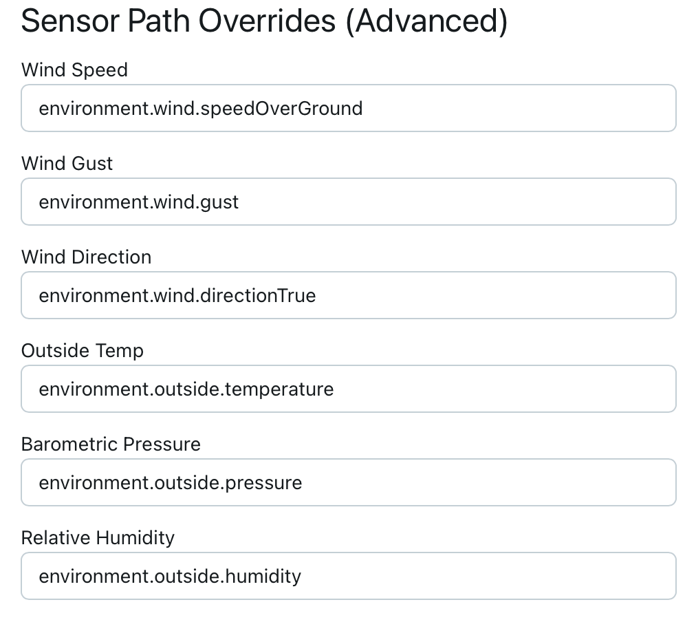

# Signal K Windy API v2 Reporter


This plugin gathers environmental data from a Signal K server and reports it to Windy.com as a Personal Weather Station (PWS) using the **v2 API**. It is designed specifically for moving vessels, utilizing separate endpoints for data (Wind, Gusts, Temperature, Pressure, and Humidity) and station metadata to ensure reliable map updates and minimal bandwidth usage.

## Project Status

Stable and actively maintained. See [CHANGELOG.md](CHANGELOG.md) for release history and [Issues](https://github.com/Peter-Petrik/signalk-windy-apiv2/issues) for planned work.

This is the only Signal K plugin targeting the Windy v2 API. Users of the legacy [signalk-windy](https://github.com/Saillogger/signalk-windy-plugin) plugin can follow the [Migration Guide](MIGRATION.md) to switch.

## Features

- **API v2 Compliance**: Uses the latest Windy protocol with separate `GET` (observations) and `PUT` (station management) requests.
- **Rate Limit Awareness**: (v1.3.0+) Handles Windy's 429 rate limit responses by rescheduling precisely to the provided `retry_after` window instead of discarding observations or reporting errors.
- **Stale Reading Protection**: (v1.6.0+) A sensor reading that has not been updated for 15 minutes is left out of the report, so a sensor that has stopped is not reported as current weather. The limit is a setting and can be switched off.
- **Live Heartbeat Status**: Enhanced dashboard feedback showing countdown to next report, distance from baseline, current sensor readings, and last submission time. See [Dashboard Status](#dashboard-status).
- **Radius-Based Movement Guard**: Intelligent GPS reporting that triggers map updates only when the vessel moves beyond a set radius from its last position, preventing "phantom movement" while at anchor.
- **Peak Gust Tracking**: Captures the highest wind speed reading at 1Hz between reporting intervals, ensuring short-lived gusts are not missed by the 5-minute reporting cycle.
- **State Persistence**: (v1.5.2+) Saves the movement baseline and reporting schedule to `state.json` after every reporting cycle, so both survive a plugin restart, a server restart, a reboot and a power loss.
- **Smart Unit Conversion**: Automatically handles conversion from Signal K base units (Kelvin, Pascal, m/s) to Windy standards (°C, Pa, m/s).

## Mapped Data

### Observations

Each reporting cycle sends one observation built from the Signal K paths below. The paths are defaults and can be changed under **Sensor Path Overrides (Advanced)** in the plugin configuration. A path with no value is left out of the observation. So is a reading older than the **Maximum Reading Age** (see [Stale Readings](#stale-readings)), and a value that is not a number or lies outside the range Windy accepts for its field; Windy rejects a whole observation for one such field, so leaving it out keeps the other readings reported. The debug log names every reading that was left out.

| Measurement | Signal K Path (Default) | Windy Parameter | Conversion |
| :--- | :--- | :--- | :--- |
| Wind speed | `environment.wind.speedOverGround` | `wind` | None (m/s) |
| Wind gust | `environment.wind.gust` | `gust` | None (m/s). The highest wind speed seen since the last report is sent when it is higher, or when the path has no value. The gust is never sent below the wind speed of the same report |
| Wind direction | `environment.wind.directionTrue` | `winddir` | Radians to whole degrees, folded into 0 to 359 |
| Temperature | `environment.outside.temperature` | `temp` | Kelvin to °C |
| Pressure | `environment.outside.pressure` | `pressure` | None (Pa) |
| Humidity | `environment.outside.humidity` | `rh` | Ratio to percent |

`environment.outside.humidity` is the humidity path of the Signal K specification and the one Signal K's own NMEA 0183 and NMEA 2000 converters publish. Versions before 1.5.2 read `environment.outside.relativeHumidity`. When the configured path is one of these two and holds no value, the other is read, so an existing configuration needs no change. `environment.wind.gust` is not a path in the Signal K specification; where no source publishes it, the gust is the highest wind speed seen since the last report.

### Station Record

When the vessel has moved beyond the movement threshold, the plugin updates the station record on Windy before sending the observation.

| Station Field | Source |
| :--- | :--- |
| `lat`, `lon` | `navigation.position`, rounded to five decimals |
| `elev_m` | **Station Elevation** if set. Otherwise `navigation.gnss.antennaAltitude` if it holds a current number, otherwise `navigation.altitude`, otherwise 0; rounded to a whole metre |
| `name`, `operator_text` | **Display Name** |
| `station_type` | **Station Type** |
| `operator_url` | **Operator Website URL** |
| `share_option` | **Share Option**: `public` for **Public**, `only_windy` for **Windy only** |
| `agl_wind`, `agl_temp` | **Wind Sensor Height** and **Temperature Sensor Height** |

The two sensor heights describe how far each sensor is above the waterline. They are not the station elevation. The elevation Windy shows for the station ("AMSL") is `elev_m`. It is taken from the GNSS altitude, which can be several metres off and on a sailing vessel may be the height of an antenna; the **Station Elevation** setting (v1.6.0+) replaces it with a fixed value.

A station update is not sent with a position older than the **Maximum Reading Age**, since the vessel may have moved in the meantime.

## Compatibility

| | |
| :--- | :--- |
| Node.js | 20 or later (`engines` in `package.json`) |
| Automated tests | Run on Node.js 20.20.2, 22.22.0 and 24.21.0 |
| Signal K server | Loaded and started on Signal K server 2.31.1, 2.32.0 and 2.33.0; reporting cycles, including a reading going stale, were run on 2.33.0, and the subscription behaviour the age check relies on was confirmed on 2.31.1 and 2.33.0 |
| Plugin CI | The [Signal K plugin CI](https://github.com/SignalK/signalk-server/blob/master/.github/workflows/plugin-ci.yml) runs on every push: the tests on Linux, Linux arm64, macOS and Windows with Node.js 22 and 24, and an integration check against Signal K server 2.31.1, 2.32.0 and the latest release |

Signal K server versions older than 2.31.1 have not been tested with this release. Earlier releases of the plugin were developed on Signal K server 2.21 and 2.22.

## Prerequisites

- **Windy station**: A station registered at [stations.windy.com](https://stations.windy.com), which provides the **Station ID** and the **Station Password**.
- **Windy API key**: A key created on the API Keys page at [stations.windy.com](https://stations.windy.com).
- **Position Data**: A valid GPS source providing `navigation.position`.
- **Derived Data (Optional)**: For vessels without direct SOG or True Wind sensors, the `signalk-derived-data` plugin is recommended to provide the necessary calculated paths.

## Quick Start Guide

1. **Register the Station**: Log in to [stations.windy.com](https://stations.windy.com) and click **+ Add Station**.
2. **Collect Credentials**:
   * Create an **API Key** on the API Keys page.
   * Copy the **Station Password** from the station details.
   * Copy the **Station ID** (e.g., `f0123456`) from the station list.
3. **Install the Plugin**: In the Signal K admin UI, open **Apps & Plugins > Store**, search for `signalk-windy-apiv2`, install it, and restart the Signal K server.
4. **Configure the Plugin**: Open **Apps & Plugins > Configuration**, select **Windy API v2 Reporter**, enter the three credentials and set the **Display Name**, which is the name shown on the Windy map. Click **Save Configuration** below the form; saving the configuration for the first time also enables the plugin.
5. **Set Movement Guard**: Choose a distance threshold (default 300m). The station position on Windy is updated only when the vessel moves beyond this distance from the last reported point.
6. **Check the Dashboard**: After 15 seconds the plugin status shows the reported readings and a countdown to the next report. Until all three credentials are entered, the status reads "Not configured" and nothing is sent.

Windy publishes the same setup in its own documentation: [Signal K guide on Windy Stations](https://stations.windy.com/docs/guides/Signal%20K).

Users migrating from the legacy signalk-windy plugin should follow the [Migration Guide](MIGRATION.md).

## Technical Details

### Dashboard Status

The plugin's line on the Signal K dashboard has this form:

```
Next: 4m53s | Δ6m | W:4.1 G:5.6 D:306 T:20.5 P:101.9 H:64 | 20:43
```

| Part | Meaning |
| :--- | :--- |
| `Next: 4m53s` | Time until the next report. `Warm:` during the 15 seconds after a start, `Resume:` when a countdown from before a restart is continued |
| `Δ6m` | Distance from the position last sent to Windy. `Forced` in its place (v1.6.0+) while **Force GPS Updates** is on |
| `W:` `G:` `D:` `T:` `P:` `H:` | The readings of the last report: wind and gust in knots, direction in degrees, temperature in °C, pressure in kPa, humidity in percent |
| `H:-` | (v1.6.0+) A reading exists for this field but was left out: older than the Maximum Reading Age, not a number, or outside the range Windy accepts. A field with no reading at all is not shown |
| `20:43` | Time of the last report, in the time zone of the server. A Raspberry Pi set to UTC shows UTC |

When a cycle has nothing to send, the readings give way to the first path without a usable reading and the number of further ones (v1.6.0+):

```
Next: 4m53s | Δ6m | No data: environment.wind.speedOverGround +4
```

This is shown as a plain status, not as an error: instruments that are switched off are the usual reason.

### Stale Readings

Signal K keeps the last value of a path for as long as the server runs, so a sensor that was switched off an hour ago still has a value there. From v1.6.0 the plugin takes every reading from its live subscription and notes when it arrived. A reading that has not been updated within the **Maximum Reading Age** (default 15 minutes) is not sent, and the dashboard shows it with a dash.

A sensor that sends a value only when the value changes can exceed the limit while working correctly, for example a humidity sensor on a steady night. For such a sensor the limit can be raised, or set to 0 to switch the check off.

### Real-Time Log Monitoring
To stream logs specifically for this plugin on an installation created with `signalk-server-setup`:
```bash
journalctl -u signalk -f | grep "signalk-windy-apiv2"
```

### Restart vs Full Reset

The plugin maintains persistent state in a `state.json` file within the Signal K data directory, saved after every reporting cycle. There are two levels of reset depending on the situation.

**Restart (apply config changes):** Open **Apps & Plugins > Configuration**, select the Windy API v2 Reporter, and click **Save Configuration** below the form. This restarts the plugin with the current settings. The movement baseline, reporting timer, and position establishment state are preserved — only configuration changes (credentials, interval, thresholds) take effect.

**Full reset (clear all state):** Disable the plugin, delete its `state.json` file, and enable the plugin again. The plugin has to be disabled first, because a running plugin saves its state again at the next cycle and when it stops. This clears the movement baseline, resets the reporting timer, and forces a fresh position update to Windy on the next reporting cycle. The state file is located at:

```
~/.signalk/plugin-config-data/signalk-windy-apiv2/state.json
```

A full reset is useful after migration from the legacy plugin, when the station position on Windy needs to be re-established, or when troubleshooting position-related issues.

### Diagnostic Reporting
To generate a log summary for troubleshooting:

```bash
journalctl -u signalk -n 100 --no-pager | grep "signalk-windy-apiv2"
```

When sharing logs, redact the **Station Password** and **API Key** before posting to public forums or GitHub issues.

### Troubleshooting

**Confirming credentials are valid.** The plugin validates credentials implicitly on each reporting cycle: a successful submission means the credentials are correct. There is no separate "test" action — if the dashboard shows sensor readings and a normal countdown after the warm-up period, the Station Password, API Key, and Station ID are all working. The verdict appears on the first reporting cycle after the plugin starts or is restarted by saving its configuration (after the 15-second warm-up on a fresh start, or after the remaining interval on a resume), not at the moment the configuration is saved.

**Error messages.** The messages below were checked against the Windy API on 2026-10-10.

1. **"Not configured: enter ..."** — One or more of the three credentials is missing. The message names them. Nothing is sent until all three are entered.
2. **"Station Password rejected by Windy"** — The Station Password is incorrect. Verify it against the station detail page at [stations.windy.com](https://stations.windy.com).
3. **"Station ID and Station Password do not belong together"** — The Station ID and the Station Password are not those of the same station. Verify both against the station detail page.
4. **"Windy rejected the Global API Key (403)"** — The Global API Key is incorrect. Verify it on the API Keys page.
5. **"Windy does not know this Station ID (404)"** — No station has this ID. Verify it on the station list.
6. **"No data: ..."** — Not an error. No sensor path has a usable reading, so there is nothing to send. The line names the first such path. A path that is not published at all needs a source or a different path under **Sensor Path Overrides (Advanced)**; a path whose sensor has stopped is reported again when the sensor resumes.
7. **"Station position not updated: Share Option ..."** — The saved Share Option is one Windy does not accept, or none is saved. Observations are still sent, but the position on the map is not updated until **Public** or **Windy only** is selected. Versions before 1.5.2 offered a **Private** option, which Windy rejects.
8. **"Metadata update failed (400)"** — Windy rejected the station record. The server log holds Windy's answer.
9. **"Observation failed: Status 400: ..."** — Windy rejected the observation and names the field in the message. A message about `ts` means the system clock of the server is wrong: Windy accepts no time in the future and none more than two hours in the past.
10. **"Reporting cycle failed: ..."** — An error the plugin did not foresee. The plugin reports again at the next cycle; the server log holds the details, which are worth including in a bug report.

**Pressure not shown on the Windy station page.** Pressure data is transmitted correctly but may not appear in the Windy station UI. Windy displays pressure only for professional stations; for personal weather stations the value is accepted and stored (visible in the data graph) but not shown in the station inspector. This is a Windy display limitation, not a plugin issue — the data is being reported.

## Known Limitations

1. **An operator logo set on Windy is removed by position updates.** Windy replaces the whole station record on every update and offers no way to send a position alone. The plugin does not resend a logo, so a logo uploaded at [stations.windy.com](https://stations.windy.com) is removed the next time the vessel moves beyond the movement threshold.

## Future Enhancements

* **Precipitation Support**: The Windy API v2 accepts a `precip` parameter for rain in mm for the last 60 minutes. With access to a rain gauge providing the appropriate Signal K path, this would extend the reported data set.

* **Offline Observation Queue**: Buffer observations when connectivity is unavailable and replay them when the connection returns. Windy accepts an observation time up to two hours in the past, which bounds what a queue can replay.

## Support

For bug reports and feature requests, open an issue at [GitHub Issues](https://github.com/Peter-Petrik/signalk-windy-apiv2/issues). Include the Signal K server version, plugin version, and relevant log output (see Diagnostic Reporting above).

Contributions are welcome — see [CONTRIBUTING.md](CONTRIBUTING.md) for guidelines.

## Screenshots

### Vessel on Windy Map


### Dashboard Status


### Plugin Configuration





## License

Copyright 2026 Peter Petrik. Licensed under the [GNU General Public License v3.0 or later](LICENSE).
